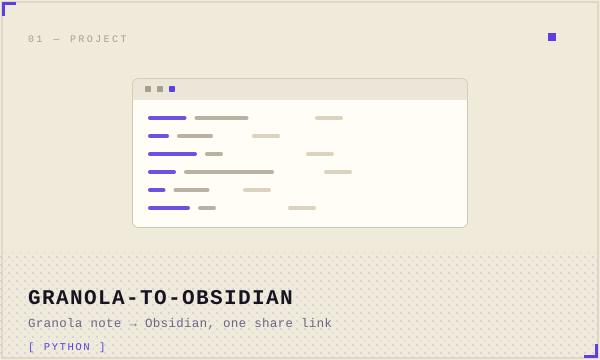
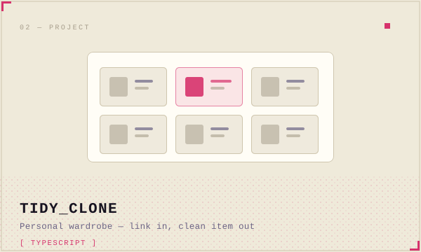

  

  инженер · небольшие инструменты · macOS, Python, TypeScript

  
  

## Сейчас

Довожу до конца два личных проекта. **granola-to-obsidian** переносит одну заметку Granola в Obsidian по публичной ссылке — без API-ключа, OAuth и платного тарифа. Ставится одной командой, живёт как macOS Service и вызывается с клавиатуры.

**tidy_clone** — цифровой гардероб для одного человека: вставляешь ссылку на вещь с Wildberries, получаешь чистое изображение и категорию, из вещей собираются образы. PWA на GitHub Pages, воркер на Cloudflare, 538 тестов. Осталось подключить ключ генерации и прожить с ним неделю.

## Стек

Python · TypeScript · Node · macOS automation · Cloudflare Workers · GitHub Actions · Obsidian

  <a href="https://github.com/Zakhvatov">github.com/Zakhvatov</a>

